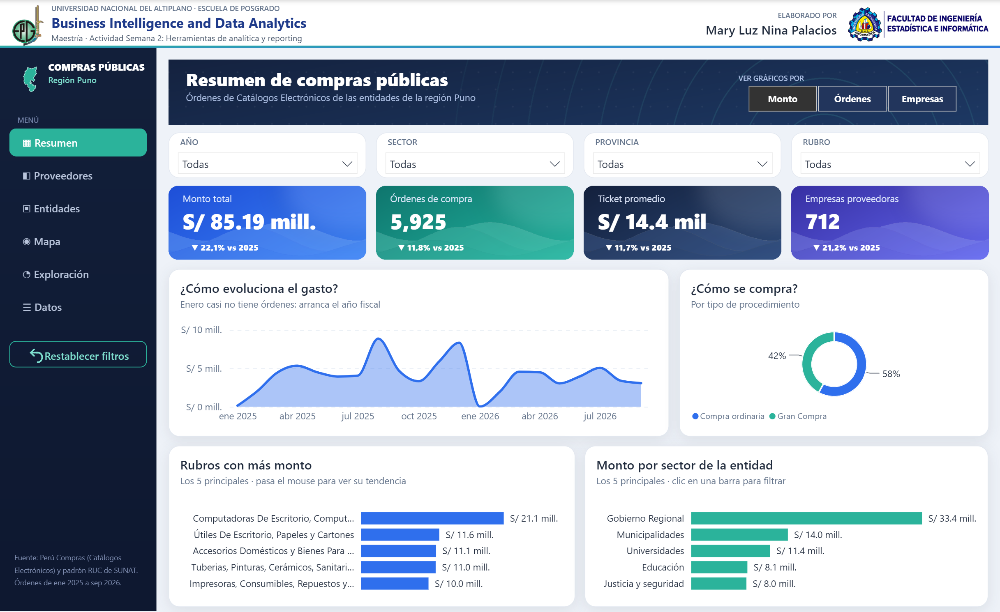
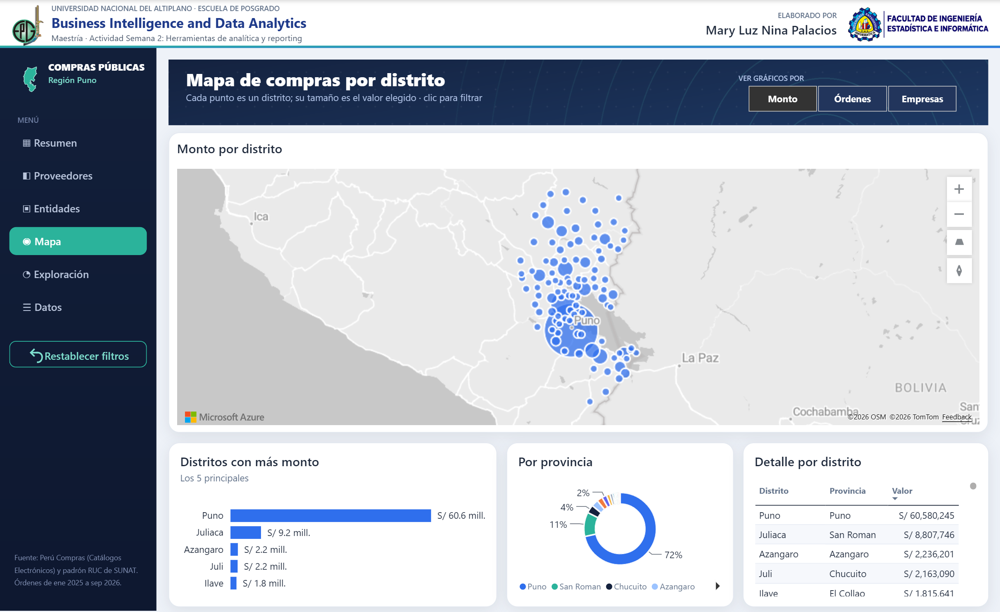

# Compras públicas · Región Puno (Power BI)

Módulo de análisis exploratorio de datos (EDA) y *reporting* desarrollado en **Power BI** sobre las órdenes de compra que las entidades públicas de la región Puno emitieron mediante los Catálogos Electrónicos de Perú Compras, entre enero de 2025 y septiembre de 2026.

**Universidad Nacional del Altiplano · Escuela de Posgrado**
Maestría · Curso *Business Intelligence and Data Analytics*
Actividad Semana 2: Herramientas de analítica y *reporting*

**Elaborado por:** Mary Luz Nina Palacios

🔗 **Reporte en línea (público):** https://app.powerbi.com/view?r=eyJrIjoiMmJlMGJlMjQtZmU5My00YzU3LWEwZGYtMjdlNGJiZDMzNDMwIiwidCI6ImM0YTY2YzM0LTJiYjctNDUxZi04YmUxLWIyYzI2YTQzMDE1OCIsImMiOjR9

📄 **Informe comparativo Shiny frente a Power BI:** [informe/Semana 2 - Informe Mary Luz Nina Palacios.pdf](informe/Semana%202%20-%20Informe%20Mary%20Luz%20Nina%20Palacios.pdf)

🔗 **Versión en Shiny del mismo análisis:** https://github.com/mlnp-dev/compras-puno-shiny · https://mlnp.shinyapps.io/compras-puno/



## Contenido del reporte

| Página | Qué muestra |
|---|---|
| **Resumen** | Monto, órdenes, ticket promedio y empresas con su variación frente a 2025; evolución mensual, tipo de procedimiento, rubros y sectores. |
| **Proveedores** | Concentración de las ventas, empresas que hacen el 80 % del monto, origen de los proveedores y relación entre frecuencia y monto. |
| **Entidades** | Entidades compradoras, sectores y provincias. |
| **Mapa** | Una burbuja por distrito sobre Azure Maps; su tamaño es la métrica elegida. |
| **Exploración** | Media, mediana, desviación estándar, coeficiente de variación, cuartiles, montos por rango, días de emisión y órdenes atípicas. |
| **Datos** | Detalle de todas las órdenes según los filtros. |

Todas las páginas tienen un menú lateral, filtros desplegables, un selector que cambia los gráficos entre **Monto**, **Órdenes** y **Empresas**, filtrado cruzado al hacer clic, una ventana emergente con la tendencia mensual y un botón para restablecer los filtros. El modelo tiene dos tablas relacionadas (órdenes y distritos) y 54 medidas DAX.



## Datos

- **Fuente:** Perú Compras, *Órdenes de compra realizadas a través de los Catálogos Electrónicos*, Plataforma Nacional de Datos Abiertos (datosabiertos.gob.pe).
- **Filtro regional:** entidades con domicilio fiscal en el departamento de Puno (ubigeo 21, padrón RUC de SUNAT).
- **Resultado:** 5 929 órdenes; el reporte analiza las 5 925 aceptadas o pagadas (S/ 85,19 millones con IGV).

## Cómo abrirlo

1. Descargar o clonar este repositorio.
2. Abrir `powerbi/ComprasPuno.pbip` con Power BI Desktop (versión reciente). Se abre con los datos ya cargados.
3. Para volver a cargar los datos desde los CSV, ir a **Transformar datos → Administrar parámetros** y cambiar `CarpetaDatos` a la ruta de la carpeta `data/powerbi/` de tu equipo (terminada en `\`). Luego, **Actualizar**.

## Estructura

```
powerbi/ComprasPuno.pbip            Proyecto de Power BI (abrir este archivo)
powerbi/ComprasPuno.Report/         Páginas del reporte (formato PBIR)
powerbi/ComprasPuno.SemanticModel/  Modelo semántico (TMDL) con las medidas DAX
powerbi/recursos/                   Fondos, tarjetas y logos del diseño
data/powerbi/                       CSV que lee el modelo (órdenes y distritos)
data/compras_puno_2025_2026.csv     Órdenes de Puno preparadas en Python
data/ref/                           Padrón RUC (ubigeo) y límites distritales
scripts/                            Preparación de datos y generación del reporte
capturas/powerbi/                   Capturas de las seis páginas
informe/                            Informe en PDF y su fuente LaTeX (tectonic -X compile informe.tex)
```

Los scripts, en orden: `01_preparar_datos.py` (filtra Puno a partir de los archivos de Perú Compras), `03_preparar_powerbi.R` (CSV para Power BI), `06_recursos_powerbi.py` (imágenes del diseño), `04_modelo_powerbi.py` (modelo y medidas) y `05_reporte_powerbi.py` (páginas del reporte).
